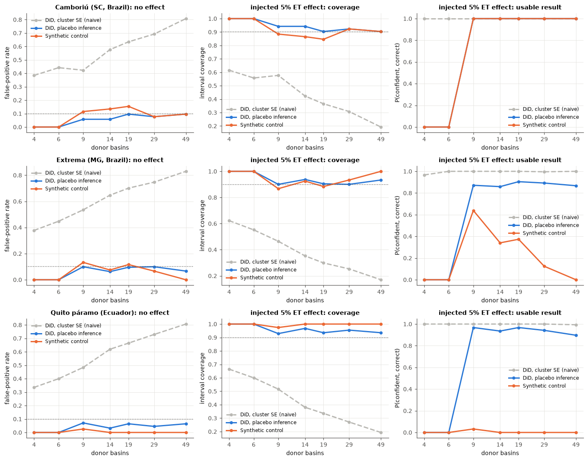
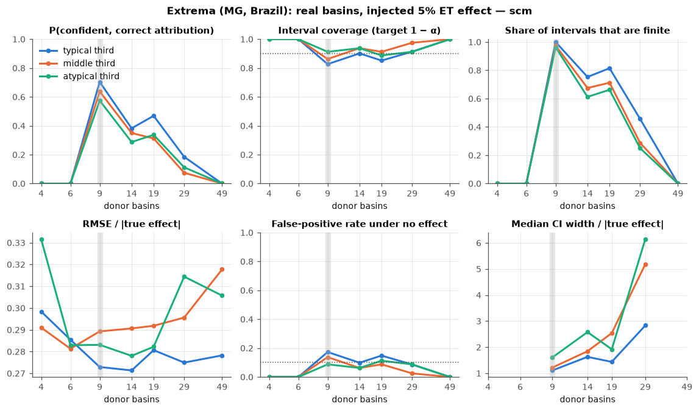
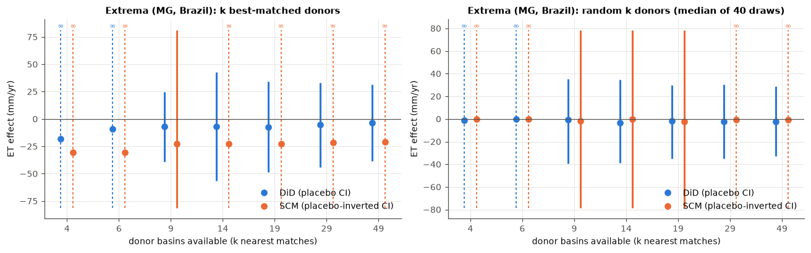

# Results on real Latin American basins

[Where attribution fails](where_attribution_fails.md) measures attribution quality on
simulated basins. This document repeats the analysis on real Earth Engine panels for
three watershed-investment programmes, two in Brazil's Atlantic Forest and one in the
Ecuadorian Andes, and asks three questions:

1. **What do the programme studies conclude?** (§1)
2. **Do the methods work on these real basins?** A known effect is injected into
   every untreated basin in each region, and we measure how often each method gets
   it right. (§2–§4)
3. **Why does attribution fail where it fails?** (§5–§7)

Everything here is reproducible with `examples/latam_results.py` (see the end). The
basin-level results are in [`results/`](results/) (`latam_*`).

## Data

| | Extrema (MG, Brazil) | Camboriú (SC, Brazil) | Quito páramo (Ecuador) |
|---|---|---|---|
| Programme | Conservador das Águas (PES, riparian restoration) | Produtor de Água do Rio Camboriú | FONAG (páramo protection and restoration) |
| Region (HydroBASINS level 9) | 252 basins, Serra da Mantiqueira | 58 basins, coastal Santa Catarina | 161 basins, northern Andes |
| Excluded as hydrologically connected | 10 | 5 | 5 |
| Start year used | 2007 | 2013 | 2005 |
| Pre-period (annual) | 6 years | 12 years | 4 years |

Monthly panels for 2001–2024: Landsat 5/7/8/9 + Sentinel-2 NDVI/EVI (harmonised,
cloud-masked), CHIRPS precipitation, MODIS MOD16 ET. These are aggregated to calendar
years. Outcomes are annual ET (mm), the evaporative index (ET/P), and annual-mean NDVI
and EVI, with precipitation as the DiD covariate and α = 0.10.

Cloud gaps: annual NDVI/EVI means use the months with a clear observation (minimum 4),
while ET and precipitation totals still require all 12 months. Before Sentinel-2
(2017+), 10–55% of basin-months lack a clear NDVI observation in the two Brazilian
regions, and **46–86% in the Quito region** (§7).

## 1. The programme studies: two bounded nulls and a design failure

Default matching (caliper 1.0 SD):

| Study | Outcome | Donors | Verdict | DiD estimate [90% CI] | SCM estimate [90% CI] |
|---|---|---|---|---|---|
| **Camboriú** | ET (mm/yr) | 22 | **No detectable effect** | +0.4 [−9.7, +10.5] | +2.4 [−7.2, +11.9] |
| Camboriú | ET / P | 21 | No detectable effect | +0.005 [−0.006, +0.016] | +0.005 [−0.007, +0.016] |
| Camboriú | NDVI | 20 | No detectable effect | +0.007 [−0.028, +0.042] | +0.009 [−0.017, +0.035] |
| Camboriú | EVI | 22 | No detectable effect | +0.006 [−0.010, +0.022] | +0.005 [−0.014, +0.025] |
| **Quito** | ET (mm/yr) | 53 | **No detectable effect** | −12.9 [−39.8, +13.9] | −8.1 [−∞, ∞] |
| Quito | ET / P | 54 | Inconclusive | +0.024 [−0.137, +0.184] | −0.013 [−∞, ∞] |
| Quito | NDVI, EVI | – | Not run: treated basin lacks NDVI in 14 of 24 years | | |
| **Extrema** | ET (mm/yr) | 6 | **Not attributable (design)** | −4.3 [−∞, ∞] | −30.5 [−∞, ∞] |
| Extrema | ET / P | 9 | No detectable effect | 0.000 [−0.027, +0.027] | +0.020 [−0.012, +0.051] |
| Extrema | NDVI | 6 | Not attributable (design) | −0.005 [−∞, ∞] | +0.003 [−∞, ∞] |
| Extrema | EVI | 9 | No detectable effect | −0.005 [−0.016, +0.006] | −0.001 [−0.010, +0.007] |

**Camboriú is a bounded null.** At the scale of the 454 km² basin, the programme did
not change annual ET by more than about 10 mm (≈ 0.9% of its 1,180 mm baseline), and
did not green the basin by more than about 0.03–0.04 NDVI. Both estimators agree.
Loosening matching to 1.5 SD (38–41 donors) leaves the ET/P, NDVI and EVI nulls
unchanged. ET itself turns INCONCLUSIVE there: the less similar donors bring in a
pre-intervention trend difference (`PRE_TREND`), and the two near-zero estimates
(−0.9 and +1.0 mm) differ in sign. Extra donors are not free.

**Quito is a bounded null on ET, from DiD alone.** The treated basin's ET change lies
between −40 and +14 mm/yr (−4% to +1.5% of its 945 mm mean annual ET), and the result holds
at 1.5 SD matching (92 donors: −15.9 [−42.8, +11.0]). Its donors are genuine highland
basins (median elevation 3,136 m, 33 of 53 above 3,000 m) with good covariate
balance. But synthetic control is uninformative: with a 4-year baseline it fits the
treated basin and 39 of the 53 placebos exactly, so its interval is unbounded (§4).
The evaporative index is too noisy in this region to say anything (DiD interval
±0.16 on a ratio near 1). NDVI cannot be analysed at all (§7).

**Extrema cannot be attributed with ET or NDVI.** Only 6 basins pass the matching
caliper, and below 9, placebo inference cannot reach p ≤ 0.10 for an effect of any
size (§3). Loosening the caliper to 1.5 SD brings in 51 donors but gives an
INCONCLUSIVE verdict: DiD gives +4.7 [−23, +33] mm and SCM gives −21 mm, and SCM's
interval is unbounded (§4). The ET/P and EVI rows reach 9 donors and are bounded
nulls, but they rest on exactly the minimum donor count.

None of these results says the programmes failed. They say that any basin-scale
change is smaller than these designs can see (§6).

## 2. Naive inference fails on real data, as it does in simulation

Each untreated basin in turn plays the treated basin, with its *k* best-matched
neighbours as donors. With nothing injected, every rejection is a false positive.



| False-positive rate (target 10%) | 4 donors | 9 | 19 | 49 |
|---|---|---|---|---|
| DiD, cluster-robust SE: Extrema | 38% | 54% | 70% | 83% |
| DiD, cluster-robust SE: Camboriú | 38% | 42% | 63% | 81% |
| DiD, cluster-robust SE: Quito | 34% | 48% | 66% | 81% |
| DiD, placebo inference: Extrema | 0% | 10% | 10% | 7% |
| DiD, placebo inference: Quito | 0% | 7% | 6% | 6% |
| Synthetic control: Extrema | 0% | 13% | 12% | 0% |

Conventional cluster-robust DiD, as most applied studies report it, calls 34–83% of
real untreated basins significant at the 10% level, in all three regions. It gets
*worse* with more donors, because with one treated basin its standard error shrinks
with the donor count while the treated basin's own idiosyncratic variation does not.
This replicates the simulation (44–78%) on real data. Its "100% usable result" in the
right-hand panels is the same failure: it rejects almost everything.

Placebo-based inference holds the nominal rate (0–15% across all cells).

## 3. Below 9 donors nothing can be attributed; above it, real basins are informative

The cliff from the simulation is exact on real data. With 4 or 6 donors, both honest
methods returned unbounded intervals and zero detections for every basin and every
injected effect (up to 10% of ET), in all three regions. From 9 donors up, DiD with
placebo inference works everywhere:

| P(confident, correct), DiD (placebo) | Effect | 9 donors | 19 | 49 |
|---|---|---|---|---|
| Camboriú | 2.5% of ET (≈ 30 mm) | 96% | 100% | 100% |
| Camboriú | 5% | 100% | 100% | 100% |
| Quito | 2.5% (≈ 28 mm) | 71% | 65% | 47% |
| Quito | 5% | 97% | 97% | 90% |
| Extrema | 2.5% (≈ 24 mm) | 37% | 41% | 39% |
| Extrema | 5% | 87% | 91% | 87% |
| Extrema, Quito | 10% | 100% | 100% | 100% |

Median 90% interval half-widths, as a share of the basin's own ET, with 9 or more donors:

| | DiD (placebo) | SCM | DiD, cluster SE (too narrow) |
|---|---|---|---|
| Camboriú | 1.0–1.5% (12–18 mm) | 0.8–1.0% | 0.2–0.3% |
| Quito | 1.8–2.5% (20–28 mm) | unbounded beyond 9 donors (§4) | 0.4–0.6% |
| Extrema | 2.8–3.2% (27–31 mm) | 3.1% at 9 donors, then wider (§4) | 0.4–0.9% |

So a typical basin with enough donors **can** support attribution: changes of about
2.5% of ET in Camboriú and about 5% in Extrema and Quito are found reliably.
Extrema's interannual ET is noisier, and Extrema and Quito have short baselines
(6 and 4 years), which give the estimator less to average over.

## 4. Synthetic control with a short baseline: more donors make it worse



With Extrema's 6 pre-intervention years, SCM's usable-result rate for a 5% effect
*falls* as donors are added: 64% with 9 donors, 34% with 14, 12% with 29, 0% with 49.
The share of bounded intervals drops from 98% to 0%. False positives do not rise;
the method simply loses all power.

The mechanism: once donors outnumber pre-periods, a convex combination can reproduce
almost any basin's short baseline exactly. That includes the *placebo* fits. Placebos
with a near-perfect pre-fit have an essentially infinite test statistic, so the
treated basin can never look extreme, and the placebo-inverted interval becomes
unbounded. The median normalised pre-period RMSPE shows it:

| Median normalised pre-RMSPE | 9 donors | 19 | 49 | Pre-years |
|---|---|---|---|---|
| Camboriú | 0.26 | 0.23 | 0.13 | 12 |
| Extrema | 0.18 | 0.11 | 0.04 | 6 |
| Quito | 0.16 | 0.006 | 0.000 | 4 |

Quito, with 4 pre-years, is the limiting case: SCM gave a usable result for **0–5%**
of basins at every donor count, even for a 10% effect
([figure](figures/latam_injection_quito_paramo_scm.png)). Camboriú, with a 12-year
baseline, shows no collapse: SCM stays at 100% usable from 9 to 49 donors.

The rule is practical. **Keep the SCM donor pool well below the number of
pre-periods, or rely on DiD,** which does not have this failure (Extrema DiD: 87–91%,
Quito DiD: 90–97%, across 9–49 donors). An excellent pre-period fit is not evidence
of a good counterfactual. The simulation reached the same conclusion from the other
side: there, the best-fitting SCM had the worst false-positive rate. The study
report now raises an `SCM_OVERFIT` flag when this happens.

## 5. The programme basin is the atypical one



Extrema's region is not short of good controls in general. A typical untreated basin
there has a median of **92** suitable donors, and only 3% have fewer than 9. The
programme basin has **6**:

| Extrema treated basin vs region (SD from regional mean) | |
|---|---|
| Elevation (1,407 m vs regional median 847 m) | +2.7 |
| Forest cover | +2.3 |
| Slope | +1.5 |
| Baseline ET | +1.3 |
| Overall atypicality (RMS) | 1.61, **96th percentile** of the region |

This is the pattern the toolkit was built to document. Programmes target high,
steep, forested headwaters because that is where water-supply protection pays off,
and those are exactly the basins with no peers. The region would support
attribution for most of its basins, but not for the basin the money went to.

The other two programme basins are typical of their regions, and both yield
bounded nulls. Camboriú's sits at the 12th percentile of atypicality with 22
suitable donors. Quito's sits at the 55th percentile: at 3,883 m it is high, but the
northern Andes region contains many comparable páramo and montane basins, and 53 of
them pass the caliper.

Donor thinning (above) shows the conclusions do not hinge on which donors are used:

- **Extrema:** with the *k* best matches, the DiD estimate stays between −3.6 and
  −7.2 mm for every k ≥ 9, with intervals of roughly ±30–50 mm. SCM is unbounded
  beyond 9 donors (§4). Across 40 random k-donor subsets, the spread of the DiD
  estimate shrinks from 8.8 mm (k = 4) to 2.4 mm (k = 49). No subset gives a
  significant DiD result, and 1 of 40 (at k = 9) gives a significant SCM result,
  about what chance predicts.
- **Camboriú:** the same spread shrinks from 3.4 mm to 0.3 mm, with no significant
  subsets ([figure](figures/latam_thinning_camboriu.png)).
- **Quito:** the best-match DiD estimate stays between −9.0 and −12.5 mm for k ≥ 9,
  never significant. The random-subset spread shrinks from 10.0 mm to 1.9 mm, and 3 of
  200 random subsets at k ≥ 9 are significant, fewer than chance would give
  ([figure](figures/latam_thinning_quito_paramo.png)).

Within each region, sorting pseudo-treated basins into typicality thirds changed DiD
results little for a 5% effect: 85–94% usable in every Extrema third, 100% in every
Camboriú third, and 84–100% in Quito (lowest for the least typical thirds at 49
donors). SCM in Extrema did worse for the most atypical third (57% vs 70% at 9
donors). The within-region spread of typicality is narrow compared with how far
Extrema's programme basin sits from the rest.

## 6. What basin-scale effects are plausible?

The detectable changes above (≈ 1–3% of ET at the 90% level, reliably found from about
2.5–5%) are averages over a whole HydroBASINS level-9 unit (roughly 100–750 km²).
An intervention changes ET only where land management changed. As an illustration
only, not a measured figure for any of these programmes: restoring 5% of a basin in a
way that raises ET on that land by 20% moves basin ET by about 1%. That is at
Camboriú's detection limit and well below Extrema's and Quito's.

So the bounded nulls in §1 rule out large basin-scale changes. They cannot rule out
real effects concentrated in the restored footprint. Reaching those needs smaller
units (HydroBASINS level 11–12, or custom catchments drawn around the contracted
properties) and the programmes' actual footprints and dates. Smaller units bring
fewer pixels and noisier records, so the trade-off has to be measured with this same
injection experiment.

## 7. Cloud: a third way attribution fails

Donor scarcity (Extrema) and short baselines (Quito's SCM) are design failures. Quito
adds a data failure. Before 2013, 46–86% of basin-months in the region have no clear
optical observation. Even with the relaxed 4-month rule, the treated basin has an
annual NDVI value in only 10 of 24 years, and only **13 of 161** basins have a
complete annual series. The vegetation outcome a páramo programme is most directly
meant to change cannot be measured consistently from Landsat, so NDVI attribution
is impossible. Among those 13 basins, injected NDVI effects of 5% were found 8% of the
time with 9 donors. In practice, attribution here rests on MODIS ET, which is itself
built partly from gap-filled vegetation inputs.

This is the failure mode the methodology anticipates ("persistent cloud ... silently
thins the donor pool"), now measured. A radar-based vegetation proxy (Sentinel-1,
2015+) or an annual dry-season composite would be the way around it, at the cost of a
shorter or noisier record.

## Caveats

- **Locations and dates are approximate.** Each study uses one reference point and
  the programme launch year (`examples/latam_water_funds.toml`). Real programmes
  expand over years and across sub-basins. The Camboriú point falls in a 454 km²
  unit whose mean elevation is 92 m, so it likely includes the lower basin and the
  coast, not just the headwaters where the programme works.
- **MODIS ET is model output partly driven by vegetation indices**, so the ET and
  NDVI results are not independent evidence. In the Andes, its inputs are degraded by
  the same persistent cloud that limits NDVI.
- **Injected effects are clean, immediate steps.** Real effects ramp up over years,
  so power against real interventions is lower than reported here.
- **Connectivity among untreated basins** was not used to screen donors for the
  pseudo-treated basins; only basins connected to the real programme were excluded.
  Neighbouring donors that share flow paths can share shocks, which may make the
  injected-effect results slightly optimistic.

## Reproducing

```bash
wiat extract --config examples/latam_water_funds.toml --project <ee-project> --out data   # ~30-45 min per study
python examples/latam_results.py --data data --out docs/results --fig-dir docs/figures     # ~1 min
```
