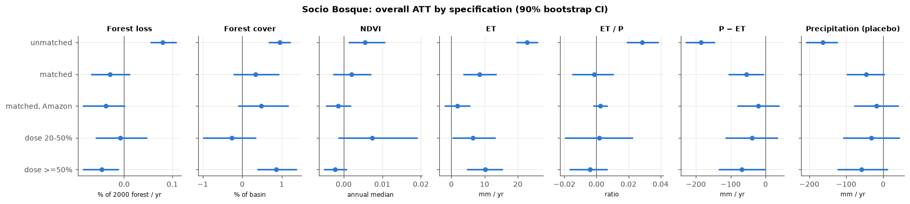
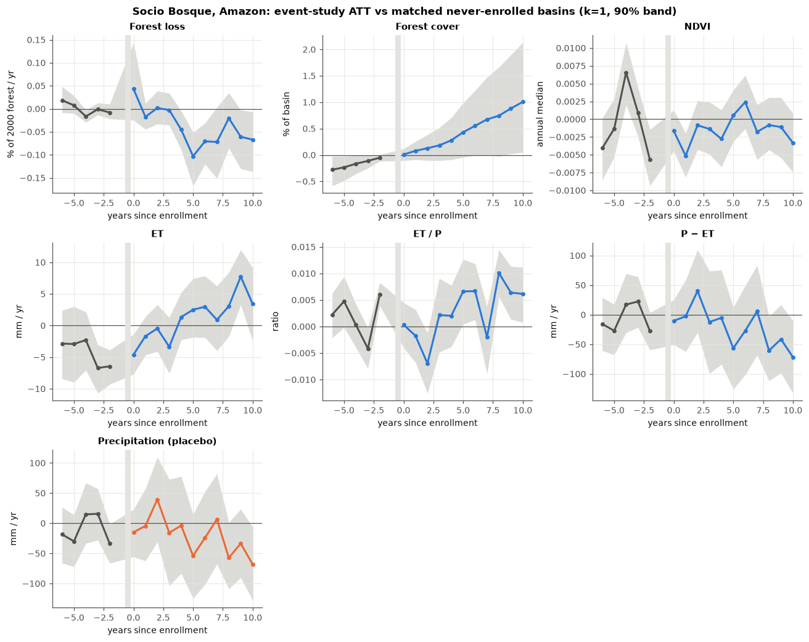

# Socio Bosque and catchment hydrology: results

The design is in [socio_bosque_plan.md](socio_bosque_plan.md). In short: 1,927 HydroBASINS
level-12 basins in mainland Ecuador. A basin is treated from the first full year after
≥ 20% of its area is under a Socio Bosque agreement (162 basins, cohorts 2008–2016).
Each treated basin is matched to its nearest never-enrolled basin (≤ 1% enrolled), within
its region (Amazon / Andes / Coast), on 2001–07 forest cover, forest-loss level and
trend, NDVI, ET, precipitation, elevation and slope. Effects are Callaway–Sant'Anna ATTs
with a basin bootstrap stratified by cohort (499 draws), reported as 90% intervals.
Annual panels run 2001–2024.

Reproduce with `examples/socio_bosque.py` (prepare / extract / assemble) and
`examples/socio_bosque_analysis.py`. Results are in `results/socio_bosque_*`.

## Summary

1. **Matching is essential.** Treated basins are remote, flat, almost fully forested
   Amazonian land under collective title. Before enrollment they lost forest about
   6½× more slowly than never-enrolled basins. Unmatched comparisons say Socio Bosque
   *increased* deforestation and cut rainfall by 163 mm/yr. Both are artefacts of
   selection.
2. **First stage: modest avoided deforestation in the Amazon.** Against matched controls,
   enrolled Amazonian basins lost **0.04–0.06 percentage points less of their forest per
   year**, roughly 20–35% below the controls' 0.18%/yr. The effect emerges about four
   years after enrollment, and appears where ≥ 50% of the basin is enrolled but not at
   20–50%. It is negative in every matching specification, but its 90% interval only
   just reaches zero in the best-balanced one.
3. **No detectable hydrological effect, and none should be expected.** NDVI, ET, ET/P and
   P − ET show no change in the Amazon. ET is bounded within a few mm/yr (about ±0.4%).
   The forest saved, about 0.5–1% of each basin over a decade, is too little to move
   basin ET by more than an estimated 1–4 mm/yr, below what the design can resolve.
4. **Pooled across regions, a rainfall placebo fails.** Basin-level hydrology estimates
   outside the Amazon (27 treated basins) are confounded by climate.

This is the toolkit's central finding in a design that should favour attribution:
135 treated Amazonian basins, hundreds of candidate controls, and a 7–15-year baseline.
Attribution works for the vegetation channel (forest loss) and fails for the
hydrological one, because the hydrological signal of a conservation programme is
smaller than the noise floor of basin-scale remote sensing.

## 1. Selection and balance

| Standardised mean difference, treated vs controls | Unmatched (1,278) | Matched (92 controls, k = 1) |
|---|---|---|
| Forest cover 2001 | 1.05 | 0.12 |
| Baseline forest-loss rate (asinh) | −1.31 | −0.23 |
| Baseline loss trend | −0.25 | −0.02 |
| Baseline NDVI | 1.20 | 0.13 |
| Baseline ET | 1.11 | 0.19 |
| Baseline precipitation | 1.07 | 0.12 |
| Elevation | −0.57 | −0.13 |
| Slope | −0.68 | −0.15 |

With one control per treated basin, every covariate is within the usual 0.25 threshold.
Using more controls per basin (k = 2, 3, 5) narrows intervals but loosens balance
(maximum |SMD| 0.30, 0.38, 0.43). Those results are reported as sensitivity checks.

The unmatched comparison shows what selection does:

| Unmatched ATT | Estimate [90% CI] |
|---|---|
| Forest loss (pp of 2000 forest / yr) | **+0.080** [+0.054, +0.109] |
| Precipitation, placebo (mm/yr) | **−163** [−209, −123] |
| ET (mm/yr) | +22.8 [+19.5, +26.1] |

A forest-protection programme cannot cut rainfall by 163 mm/yr. The unmatched controls
are drier, more deforested basins on different trajectories.

## 2. Forest loss: the first stage

| Forest loss (pp of 2000 forest / yr) | k = 1 | k = 2 | k = 3 | k = 5 |
|---|---|---|---|---|
| Amazon (135 treated) | −0.038 [−0.086, +0.002] | −0.053 [−0.095, −0.011] | −0.056 [−0.096, −0.020] | −0.061 [−0.093, −0.030] |
| All regions (162) | −0.029 [−0.069, +0.012] | −0.029 [−0.065, +0.007] | −0.024 [−0.058, +0.013] | −0.026 [−0.058, +0.003] |
| Max \|SMD\| | 0.23 | 0.30 | 0.38 | 0.43 |

By dose (all regions, k = 1): **≥ 50% enrolled: −0.047 [−0.086, −0.011]** (86 basins,
82 of them Amazonian); 20–50% enrolled: −0.008 [−0.059, +0.048] (76 basins).

The Amazon event study shows the timing. Loss rates are indistinguishable before
enrollment (leads within ±0.02 pp, one of five excluding zero). They stay near zero
for the first three years, then run 0.05–0.10 pp/yr lower in most years from year 4
on (−0.02 in year 8). That pattern
fits protection of forest that clearing pressure reaches only later.

Two cautions:

- **Cumulative forest cover has a pre-trend.** Even matched, controls lost slightly more
  forest before enrollment (SMD −0.23 on the baseline rate). That small difference
  accumulates in the *cover* series: its leads drift from −0.28 to −0.05 pp over the
  five pre-years, about 0.06 pp/yr, against about 0.10 pp/yr after enrollment. Perhaps
  half of the post-enrollment cover gap continues a pre-existing difference. The *loss
  rate* outcome differences out level differences and is the cleaner first-stage
  measure.
- **The intervals run slightly narrow.** In the placebo validation (§4) they reject
  12–17% of the time where 10% is nominal. A result whose interval just excludes zero
  should be read as suggestive.

Taken together: the evidence points to avoided deforestation of about 0.04–0.06 pp/yr
in enrolled Amazonian basins, concentrated in basins mostly under agreement and
emerging with a lag. The evidence is moderate, not conclusive. Survivorship (only
active agreements are published) would bias toward finding this effect.

## 3. Hydrology: bounded nulls in the Amazon

| Amazon, matched (k = 1) | ATT [90% CI] | Treated baseline mean | Placebo-validation half-width |
|---|---|---|---|
| NDVI | −0.0015 [−0.0047, +0.0019] | 0.81 | ±0.0032 |
| ET (mm/yr) | +1.8 [−2.1, +5.7] | 1,480 | ±3.5 |
| ET / P | +0.0025 [−0.0021, +0.0070] | 0.46 | ±0.0041 |
| P − ET (mm/yr) | −20 [−82, +39] | 1,827 | ±45 |
| Precipitation, placebo (mm/yr) | −18 [−80, +42] ✓ | 3,306 | ±45 |

Nothing moves. The precipitation placebo passes, so the comparison is not visibly
confounded by climate in the Amazon. ET is tightly bounded: the interval excludes
changes larger than about 6 mm/yr (0.4%). The ET event study has pre-period leads of
−2 to −7 mm, so the comparison is not clean at the ±5 mm level, but no specification
shows a hydrologically meaningful change.

**Why no hydrological effect is expected.** The forest saved is about 0.5–1% of a
138 km² basin over 10–15 years, roughly 0.7–1.4 km². If tropical forest converted to
pasture loses 20–30% of its ET (an illustrative figure, not one measured here), that
moves basin ET by about 0.1–0.3%, or 1–4 mm/yr. That is at or below the design's
±3.5 mm resolution. P − ET is noisier still: its ±45 mm resolution is set by rainfall
variability, roughly 20 times the plausible signal.

## 4. Validation: what this design can see

The validation runs 200 times. Each time, 135 never-enrolled Amazonian basins are
assigned the real cohort years at random, and the rest serve as controls. No basin is
treated, so every rejection is a false positive.

| Outcome | False-positive rate (target 10%) | Median 90% half-width | SD of placebo estimates |
|---|---|---|---|
| Forest loss (pp/yr) | 13% | 0.069 | 0.046 |
| Forest cover (pp) | 14% | 0.77 | 0.51 |
| NDVI | 14% | 0.0032 | 0.0019 |
| ET (mm/yr) | 17% | 3.5 | 2.5 |
| ET / P | 12% | 0.0041 | 0.0026 |
| P − ET (mm/yr) | 13% | 45 | 28 |
| Precipitation (mm/yr) | 13% | 45 | 28 |

Compared with the single-basin studies ([latam_results.md](latam_results.md)), many
treated basins buy a great deal of precision: the ET resolution is ±3.5 mm/yr here, against
±12–30 mm/yr for one basin with a full donor pool. Inference is close to nominal,
where naive single-basin DiD reached 34–83% false positives. But precision is not the
binding constraint. The binding constraint is effect size: a conservation programme
changes so little land that its hydrological signal stays below even this resolution.

## 5. Outside the Amazon

Pooled across regions (162 treated), the precipitation placebo gives −46 mm/yr
[−99, +5] at k = 1 and excludes zero at k = 2, 3 and 5. Treated Andean and Coastal basins
(27) follow different rainfall trajectories from their matches, so pooled ET (+8.5
[+3.6, +13.5] mm/yr) and P − ET estimates reflect climate, not the programme. With 14
treated Andean and 13 Coastal basins, separate regional estimates would be too noisy
to be useful.

## Caveats

- **Survivorship:** only currently active agreements are published. Basins whose
  agreements ended, possibly after clearing, are missing from the treated group.
- **Treatment timing** uses signing dates. Payments and on-the-ground enforcement may lag.
- **Spillovers:** deforestation displaced from enrolled land to neighbouring basins would
  inflate the avoided-loss estimate if those neighbours are controls. The
  one-basin-buffer check in the plan is not yet run.
- **Hansen loss** counts only loss of 2000 forest; regrowth is not tracked.
- **MODIS ET** is model output partly driven by vegetation indices, and coarse (500 m).
- **EVI** was dropped: annual composites give unstable values where its denominator
  approaches zero.
