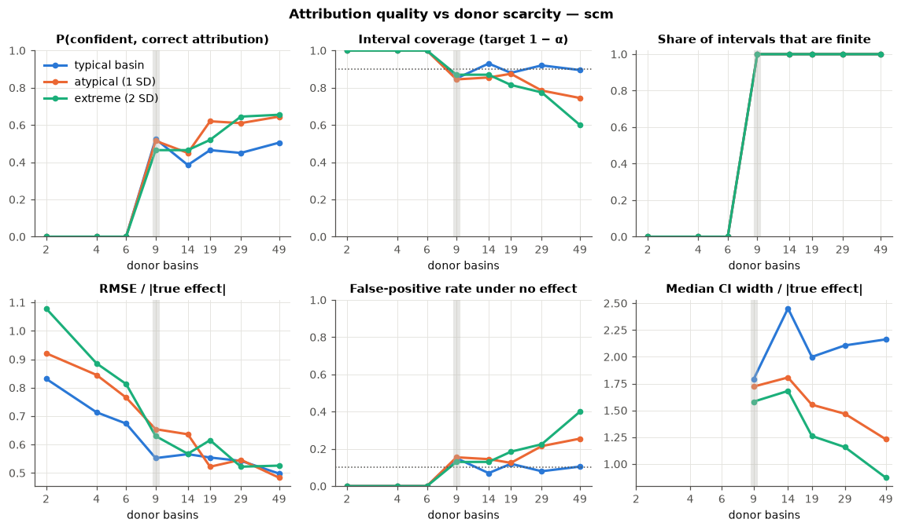
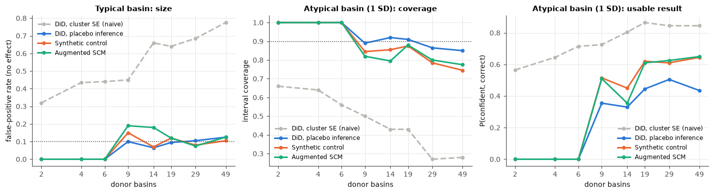
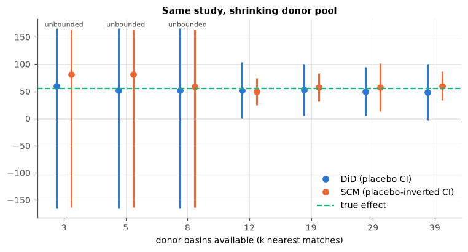
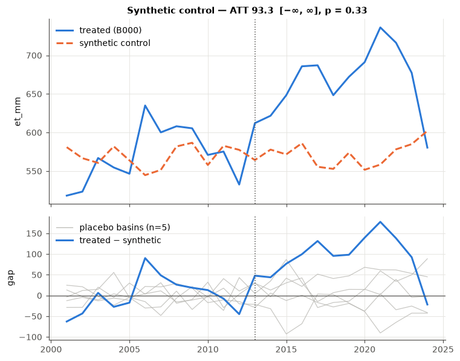

# Where attribution fails

Comparative designs (difference-in-differences, synthetic control) attribute a change
in a treated basin to an intervention by comparing it with untreated basins. This
document quantifies how attribution degrades as **suitable control basins become
scarce**. That is the normal situation for basins where nature-based investment is
actually needed: steep, wet, degraded headwaters that are atypical within their
region, whose neighbours share their drainage network and whose peers often carry
their own programmes.

All numbers below come from `wiat scarcity` (reproducible with the command at the
end). The raw replication-level results are in [`results/`](results/).

## Experiment

Each replication simulates a region of `J + 1` basins for 24 years with
`wiat.simulate.simulate_watersheds`:

- **Precipitation** follows a factor model: regional modes (ENSO-like AR(1) factors)
  load differently on each basin, so basins drift apart even without intervention.
- **Vegetation** responds to lagged water availability.
- **ET** follows vegetation, energy and water supply.

One basin receives an intervention in year 15, raising NDVI by 0.08 over four years.
That increases annual ET by about 35–55 mm (roughly 5–9%) through the vegetation coupling.
Analysis is on annual ET with precipitation as the DiD covariate.

The two axes varied:

- **Donor count** `J` ∈ {2, 4, 6, 9, 14, 19, 29, 49}: how many credible
  comparison basins are left after excluding connected, contaminated and data-poor
  ones.
- **Atypicality** of the treated basin ∈ {0, 1, 2} SD: its climate loadings,
  rainfall, elevation and forest cover are shifted toward the edge of the regional
  distribution.

Each region is observed twice with identical random draws, once with the
intervention and once without. This gives the true effect, power and false-positive
rate on the same data. 200 replications per cell; α = 0.10.

Estimators: DiD with placebo (Conley–Taber) inference, DiD with conventional
cluster-robust SEs (shown because it is what most applied studies report),
de-meaned synthetic control, and augmented SCM. All use placebo-in-space inference.



## Findings

### 1. Below 9 donors, attribution is impossible by construction

With placebo inference the smallest attainable p-value is `1/(J+1)`. At α = 0.10, no
effect of any size can be declared significant with fewer than 9 donors, and the
confidence interval is the whole real line. This is not an estimation problem, so no
amount of modelling effort fixes it. In the experiment, at `J ≤ 6`, every honest
estimator returned an unbounded interval and zero detections in every replication,
whatever the true effect.

| α | donors needed for significance to be possible | for a threshold not set by 1–2 placebos |
|---|---|---|
| 0.10 | 9 | 19 |
| 0.05 | 19 | 39 |

`wiat.scarcity.donors_needed(alpha)` returns these, and `AttributionStudy` raises
a fatal `DONOR_SCARCITY` flag below the first.

### 2. Conventional inference hides the problem by being wrong

DiD with cluster-robust SEs always returns a finite interval. With one treated basin
it is badly overconfident:

| Donors | False-positive rate, typical basin (target 0.10) | Coverage of 90% CI, typical basin |
|---|---|---|
| 4 | 0.44 | 0.55 |
| 9 | 0.45 | 0.55 |
| 19 | 0.64 | 0.36 |
| 49 | **0.78** | **0.22** |

It gets *worse* with more donors, because the SE shrinks while the treated basin's
idiosyncratic divergence does not. Roughly half of its "significant" findings are
false (share of significant claims that are true: 0.55–0.67). The naive method's
apparently high detection rate is not evidence of a better design.



### 3. Above the threshold, typical basins are attributable, but only about half the time

For a typical basin with ≥ 9 donors, placebo-based DiD and SCM hold their nominal
size (false-positive rate 0.06–0.15). Coverage is 0.85–0.94. The probability of a
confident, correct attribution is 0.38–0.58, and it does not rise systematically
from 9 to 49 donors. Median interval width is about 2× the true effect: a real 6–8% change in ET
is close to the noise floor of interannual basin variability. More donors make the
threshold less fragile but do not make a small effect large.

### 4. For atypical basins, more donors buy false confidence

When the treated basin is 2 SD from the regional centre, adding donors **narrows the
interval but does not move its centre**. The estimate stays biased because no donor
shares the treated basin's climate response:

| Donors | SCM coverage (2 SD) | SCM false-positive rate (2 SD) | DiD-placebo false-positive rate (2 SD) |
|---|---|---|---|
| 9 | 0.87 | 0.13 | 0.18 |
| 19 | 0.82 | 0.18 | 0.38 |
| 29 | 0.78 | 0.22 | 0.36 |
| 49 | **0.60** | **0.40** | **0.44** |

Placebo inference assumes the treated basin is exchangeable with the controls. An
atypical basin is not, so its untreated divergence looks "significant" against a
reference distribution built from basins that resemble each other more than they
resemble it. The pool grows while the interval narrows around a biased estimate. For
SCM, the share of significant claims that are true falls from 0.83 (typical) to 0.62
(2 SD) at 49 donors. For DiD it is 0.56.

This is the condition that characterises most basins where investment is needed. It
is why `AttributionStudy` checks pre-fit quality (`POOR_PRE_FIT`), convex-hull
support (`OUTSIDE_CONVEX_HULL`) and covariate support
(`TREATED_OUTSIDE_DONOR_SUPPORT`), not just donor counts.

### 5. Pre-fit quality is necessary, not sufficient

Median normalised pre-RMSPE for SCM rises steadily as donors thin out, from 0.29 at
49 donors to 0.96 at 2 donors for a typical basin. The share of pre-period years in
which the treated basin lies outside every donor rises from 3% to 68%. A synthetic
basin that cannot reproduce the pre-period should not be trusted for the
post-period, and `POOR_PRE_FIT` / `OUTSIDE_CONVEX_HULL` catch this.

The converse does not hold. With 49 donors, the 2 SD basin has the *best* pre-fit
in the experiment (0.17), yet the worst false-positive rate (0.40). With enough
de-meaned donors, a convex combination can mimic a 14-year pre-period while
responding differently to the climate that follows. Good pre-fit with an atypical
basin is why `AttributionStudy` also checks covariate support
(`TREATED_OUTSIDE_DONOR_SUPPORT`) and DiD/SCM agreement, and why matching precedes
weighting.

### 6. Augmented SCM does not rescue scarcity

Ridge augmentation (Ben-Michael et al.) corrects pre-period imbalance by
extrapolation. With 9 or more donors its false-positive rate (0.08–0.39) was no
better than SCM's (0.07–0.40). Its estimates were less stable at intermediate donor counts (relative
RMSE 0.86–0.89 at 14 donors versus 0.57–0.64 for SCM). Extrapolation is what you
need when the donors cannot reach the treated basin, and also what you should
believe least.

## An observed study, thinned

`donor_thinning` re-runs one study while restricting the pool to the `k` best-matched
donors. For the typical simulated basin in `examples/quickstart_synthetic.py`
(true effect +55.6 mm/yr):



- At 3–8 donors the point estimates range from 51 to 81 mm, and neither estimator
  can bound them: the intervals are unbounded.
- From 12 donors on, intervals are finite. SCM's excludes zero at every size, but the
  DiD interval at 39 donors just reaches zero (−3 to 100 mm). Near the detection
  threshold, significance depends on which basins happen to be in the pool.

The atypical basin in the same region gets **NOT ATTRIBUTABLE (DESIGN)**. Only one
candidate passes matching, the synthetic control misses 75% of pre-period years, and
its estimate (93 mm) overstates the truth (62 mm) by half:



## What to do when attribution fails

1. **Report the verdict, not just the estimate.** An unbounded interval or a fatal
   design flag is a finding. It tells funders that the monitoring design, not the
   intervention, is the binding constraint.
2. **Widen the pool deliberately.** Expand the donor region along the climate
   gradient rather than geographically, use finer HydroBASINS levels to get more,
   smaller comparison units, or use the de-meaned SCM so level differences don't
   disqualify donors.
3. **Lengthen the baseline.** Landsat back to 1985 adds pre-period years. That
   improves the pre-trend and pre-fit checks, though not the placebo resolution.
4. **Change the design.** Within-basin designs (paired sub-catchments, BACI with
   in-situ gauges, dose-response on intervention intensity) do not depend on
   regional donors. Remote sensing can supply the covariates. Plan this *before*
   the intervention, when the treated area can still be randomised or staggered.
5. **Use the detection threshold as a design tool.** Run `donor_thinning` or the
   Monte Carlo on the actual region before implementation to learn the smallest
   effect a comparative evaluation could ever detect there.

## Reproduce

```bash
pip install -e .
wiat scarcity --reps 200 --out docs/results --fig-dir docs/figures   # ~7 min on 4 cores
python examples/quickstart_synthetic.py
```

## Limits of this experiment

- One simulated data-generating process. Effect sizes, noise levels and factor
  structure are plausible for tropical Andean and Atlantic Forest basins, not
  calibrated to any specific one.
- One treated basin per replication. Several treated basins help DiD inference
  (more permutations) but not the atypicality problem.
- Annual resolution with 14 pre-period years. Monthly analysis adds observations
  but also seasonal and serial structure that the placebo distribution must absorb.
- Data-quality failures (cloud gaps, CHIRPS error in orographic rainfall, MODIS ET's
  dependence on NDVI) are not simulated. They thin and bias the donor pool further.
